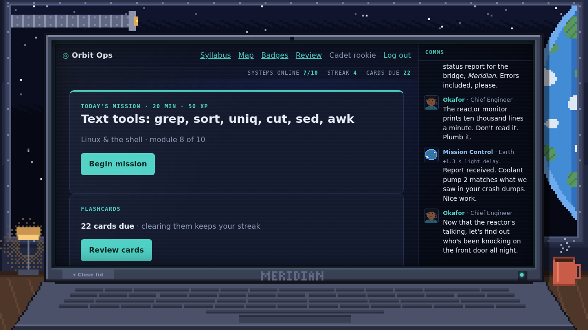
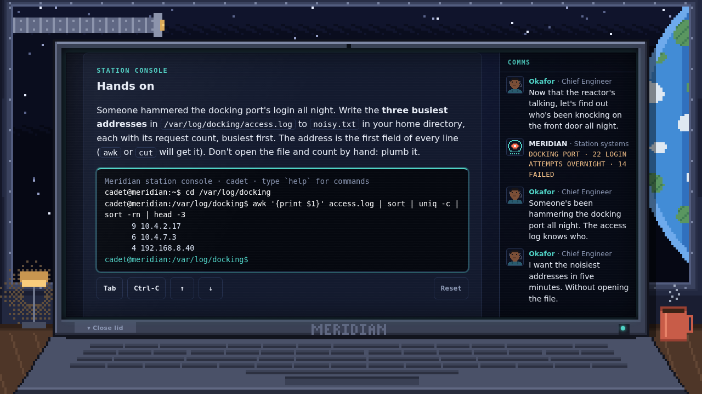
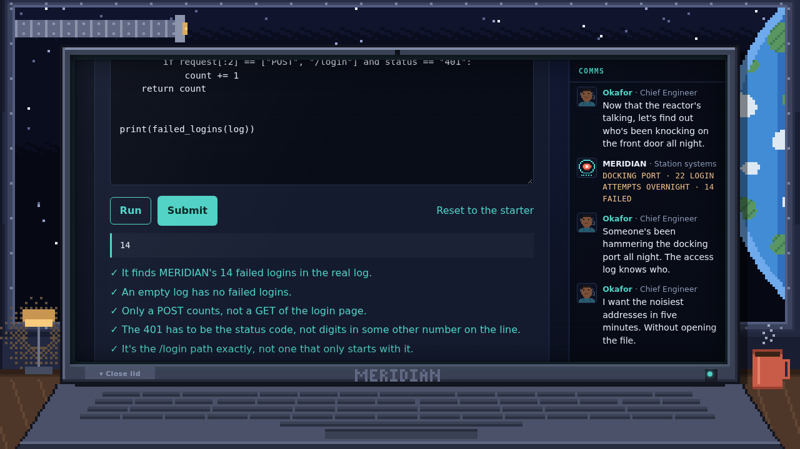
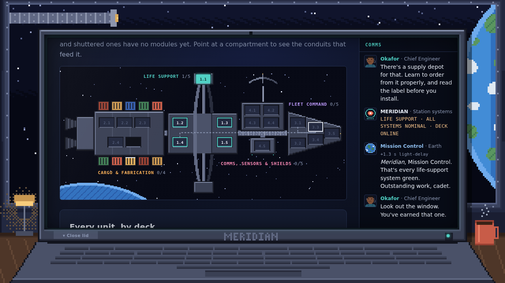
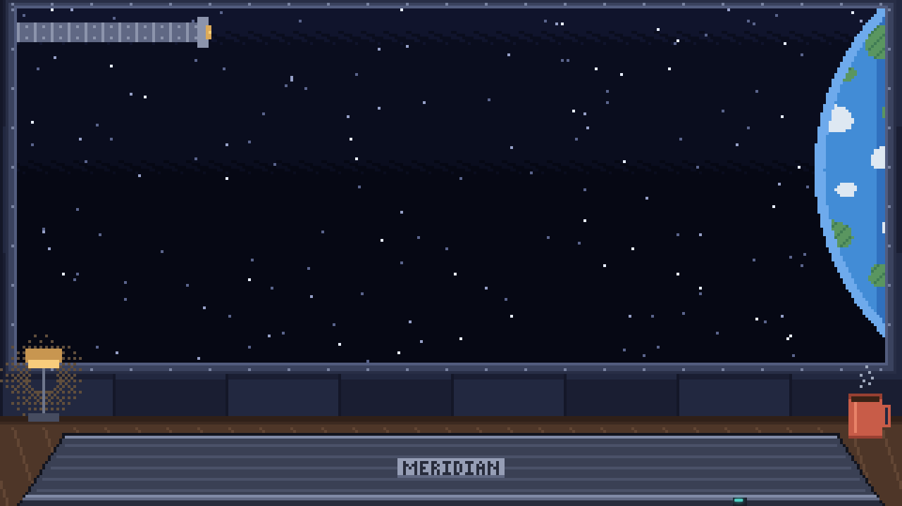

# Orbit Ops

> One DevOps module a day. Bring the space station *Meridian* back online, one system at a time.



Orbit Ops is a personal, gamified platform for learning DevOps: one 15–20 minute module a day from
a structured curriculum. It starts at the Linux shell and works up through Bash, Git, networking,
Python, Docker, Kubernetes, CI/CD, infrastructure as code, observability and security. It's a
single-user app, live at [learn.seandesmet.com](https://learn.seandesmet.com).

The curriculum is told as a story. You're a cadet aboard the orbital station *Meridian* after an
outage left it dark, and each module is a shift spent bringing one more system back. Chief
Engineer Okafor gives the orders, MERIDIAN (the station's systems) reports in terse readouts, and
Mission Control answers from Earth with a 1.3-second light-delay.

It's also how its author learns the stack it's built in: FastAPI, SQLAlchemy 2.0 and Alembic now,
Kubernetes later.

## A day aboard

Each module is one shift:

1. **The briefing** arrives on the **comms log** beside the screen, from the crew.
2. **The lesson**: short sections, a "Try it" for a real Linux machine, and notes on where the
   idea shows up in this app's own deployment.
3. **The station console**: a task on the station's own files, e.g. "find who hammered the
   docking port's login all night". It's a simulated shell that runs entirely in your browser.
   It's graded on the state you leave behind, not the keystrokes, and the crew answers when it
   passes.

   

4. **The systems check**: a short quiz. Finishing it brings the system online, with XP and a
   debrief.
5. **Practice**:
   - The module's **flashcards** join MERIDIAN's **watch drill**, scheduled with SM-2 so you see
     a card just before you'd forget it.
   - Some modules add a bonus **Python challenge**, run in your browser.

   

Every day with a finished module or a cleared drill files your **shift log** and keeps the streak
alive.

## The game around it

- **XP, levels and ranks**, from Cadet to Station Commander. Every point is traceable to the ledger
  entry that earned it.
- **Streaks** with freezes banked every seven days, so one missed day doesn't end a long run.
- **Badges**, called commendations: one per system restored, plus streak milestones.
- **The station map**: the *Meridian* drawn side on. Each track is a deck of the ship and each unit
  a compartment that lights up as you finish it. Point at a compartment to see the conduits from
  the units that feed it.

  

- **The desk**: the app lives on a laptop in your quarters. Things happen outside the window as
  the story moves: a shuttle docks, a relay satellite passes, an aurora rises when Life Support's
  first system is restored. **Close the lid** to watch.

  

## What's built, and what's planned

The app is at **v0.5.0**: everything above is live. The curriculum has just begun.

| | Today | Planned |
|---|---|---|
| Decks (tracks) | 4, all drawn on the map | 4 |
| Units | 1 written, **Linux & the shell**; 18 more outlined with their story | 19 |
| Modules | 10, with 40 quiz questions, 9 console tasks, 31 flashcards and 1 Python challenge | ~170, about six months of daily shifts |

| Deck | Track | Units |
|---|---|---|
| **Life Support** | Core Systems | Linux & the shell · Bash scripting · Git · Networking · systemd |
| **Cargo & Fabrication** | Python & Containers | Python for operations · Docker · Dockerfile hardening · Compose |
| **Fleet Command** | Kubernetes | Workloads · Config & storage · Ingress · Helm · Cluster labs |
| **Comms, Sensors & Shields** | Delivery & Reliability | GitHub Actions · Terraform · Ansible · Observability · DevSecOps |

**Next: v0.6.0, Bash scripting.** The console learns control flow, functions, an editor (`nano`),
`man`, `find`/`tar` and cron, and Unit 1.2's ten modules are written on top of it. After that comes
**v0.7.0, Labs and AI**: hands-on labs with verify checks, Claude reviewing a pasted Dockerfile
or manifest, and hints, all under a monthly spending cap. The full plan is in
[`docs/roadmap.md`](docs/roadmap.md).

## How it's built

- **Backend:** Python 3.14, FastAPI (sync routes), SQLAlchemy 2.0, psycopg 3, Alembic,
  pydantic-settings, argon2, served by a single uvicorn process.
- **Frontend:** Jinja2 and htmx, plain CSS, no build step and no framework.
- **Data:** PostgreSQL 16 in its own container. The app connects as a least-privilege role.
- **Infrastructure:** Docker Compose on a small DigitalOcean droplet shared with its sibling
  project, Budget Buddy. Images go through ghcr.io, with GitHub Actions for CI and gated releases
  (backup, migrate, deploy, health check).

Some choices worth knowing about:

- **Lessons are files, not rows.** The curriculum is Markdown with YAML front matter under
  `content/`, validated by Pydantic at startup and in CI. The database holds only the learner's
  state, keyed by permanent slugs.
- **State is derived, not stored.** Locks, streaks, the comms log and the map are computed from
  progress on each request: no scheduler, nothing to drift.
- **Learner code never runs on the server.** The console is a simulated shell in JavaScript, and
  Python challenges run in the browser through [Pyodide](https://pyodide.org). Pyodide is
  self-hosted, fetched at build time and checked by its sha256, so the Content Security Policy
  gains only `'wasm-unsafe-eval'` and no third-party origin.
- **The checks hold the content honest.** CI runs every console task's reference solution
  through the shell and every challenge's solution in real CPython. It also checks that the
  figures the crew quotes match the files they describe, and that no console task needs a command
  the lessons haven't taught yet.
- **The art is code.** The room, the laptop, the ship and the crew's portraits are drawn by
  stdlib Python in `art/`, and a test redraws each one to check it matches the committed PNG.
- **Strict by default.** Every inline script needs a per-request nonce, every POST carries a CSRF
  token, and every query is scoped to the current user even with one user. Dependencies, Actions
  and the base image are all pinned, and a test checks it.

## Run it locally

```bash
cp .env.example .env            # then set DB_PASSWORD and SECRET_KEY
docker compose up -d --build
docker compose exec web alembic upgrade head
docker compose exec web python -m scripts.create_user <username>
# open http://localhost:5002
./test.sh                       # ruff, a fresh test database, pytest and the console's JS tests
```

The dev server reloads on changes under `app/`. After editing `content/` or `art/`, run
`docker compose restart web`. Redraw the art with `python -m art.build`.

## Documentation

| Read | For |
|---|---|
| [`CONTRIBUTING.md`](CONTRIBUTING.md) | the workflow: issue → branch → PR, with Given/When/Then criteria that CI requires a test to claim |
| [`docs/architecture.md`](docs/architecture.md) | how the code fits together |
| [`docs/content-authoring.md`](docs/content-authoring.md) | writing modules: lessons, quizzes, console tasks, challenges, flashcards, comms |
| [`docs/testing.md`](docs/testing.md) · [`docs/gotchas.md`](docs/gotchas.md) | the test suite, and everything that's already gone wrong once |
| [`docs/roadmap.md`](docs/roadmap.md) · [`docs/status.md`](docs/status.md) | the plan, and where it stands |
| [`docs/deployment.md`](docs/deployment.md) · [`RUNBOOK.md`](RUNBOOK.md) | releases, migrations and production |
| [`CHANGELOG.md`](CHANGELOG.md) · [`VERSIONING.md`](VERSIONING.md) | what changed, and how versions are numbered |

## Licence

MIT, see [`LICENSE`](LICENSE). htmx is vendored under its own 0BSD licence (`app/static/`).
Pyodide (MPL-2.0) isn't in the repository: the image fetches it at build time, with its licence
alongside it.
